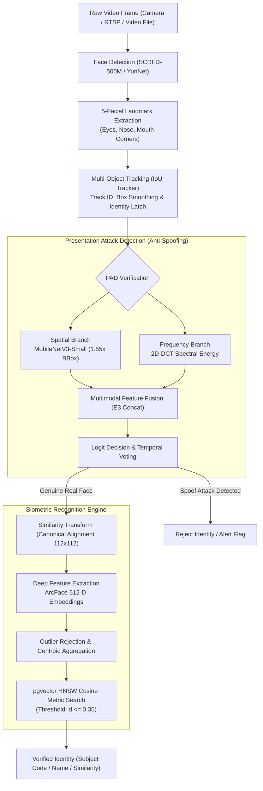

# 👁️ Face-Auth: Edge-Ready Face Biometrics & Multi-Domain Presentation Attack Detection

[](https://www.python.org/)
[](https://pytorch.org/)
[](https://opencv.org/)
[](https://github.com/pgvector/pgvector)
[-success)](antispoof/models/smartface_pad_artifacts/)
[-brightgreen)](antispoof/models/smartface_pad_artifacts/)
[](LICENSE)

An open-source, edge-optimized Computer Vision framework for **Real-Time Facial Authentication**, **Multi-Target Video Tracking**, and **Multi-Domain Presentation Attack Detection (Face Anti-Spoofing)**.

Designed for low-latency edge platforms (Raspberry Pi 4, Jetson Orin/Nano, edge servers) and scalable cloud biometric microservices.

---

## 📑 Table of Contents
- [Architecture & Processing Pipeline](#-architecture--processing-pipeline)
- [Computer Vision Modules](#-computer-vision-modules)
  - [1. Face Detection & Landmark Localization](#1-face-detection--landmark-localization)
  - [2. Multi-Face Video Tracking (MOT)](#2-multi-face-video-tracking-mot)
  - [3. Multi-Domain Presentation Attack Detection (PAD)](#3-multi-domain-presentation-attack-detection-pad)
  - [4. Canonical 5-Point Similarity Alignment](#4-canonical-5-point-similarity-alignment)
  - [5. Deep Representation Learning (ArcFace 512-D)](#5-deep-representation-learning-arcface-512-d)
  - [6. Centroid Enrollment & Metric Vector Search](#6-centroid-enrollment--metric-vector-search)
- [Experimental Benchmarks & Model Zoo](#-experimental-benchmarks--model-zoo)
- [Edge AI Optimization & Asynchronous Worker](#-edge-ai-optimization--asynchronous-worker)
- [Directory Structure](#-directory-structure)
- [Prerequisites & Installation](#-prerequisites--installation)
- [Quick Start](#-quick-start)
  - [1. Real-Time Camera Inference Application](#1-real-time-camera-inference-application)
  - [2. High-Throughput REST API Microservice](#2-high-throughput-rest-api-microservice)
  - [3. Biometric Identity Enrollment](#3-biometric-identity-enrollment)
- [Configuration Reference (.env)](#-configuration-reference-env)
- [Research & Reproducibility](#-research--reproducibility)
- [References & Citations](#-references--citations)

---

## 🏗️ Architecture & Processing Pipeline

The system processes incoming video streams through a decoupled, multi-stage Computer Vision pipeline:



---

## 🔬 Computer Vision Modules

### 1. Face Detection & Landmark Localization
* **Algorithms**:
  * **SCRFD-500M**: Sample and Computation Redistribution for Efficient Face Detection. High recall for occluded, angled, and distant faces.
  * **OpenCV YunNet**: Ultra-lightweight INT8 deep face detector (~122 KB), optimized for ARM / Raspberry Pi edge processing.
* **Outputs**: High-precision bounding box $(x_1, y_1, x_2, y_2)$, detection confidence score, and 5 facial landmarks:
  $$\mathbf{P} = \left\{ [x_{\text{left\_eye}}, y_{\text{left\_eye}}], [x_{\text{right\_eye}}, y_{\text{right\_eye}}], [x_{\text{nose}}, y_{\text{nose}}], [x_{\text{left\_mouth}}, y_{\text{left\_mouth}}], [x_{\text{right\_mouth}}, y_{\text{right\_mouth}}] \right\}$$
* **Context Expansion**: Dynamic $1.55\times$ bounding box expansion to supply spatial context (hair, ears, chin, background reflection) for anti-spoofing classifiers.

### 2. Multi-Face Video Tracking (MOT)
* **IoU Tracker with Temporal Smoothing**: Associates detected bounding boxes across consecutive frames using Intersection-over-Union (IoU) spatial matching.
* **Identity Latching & State Machine**:
  * Maintains per-track identification states (`PENDING`, `VERIFYING`, `CONFIRMED`, `SPOOF`, `REVERIFY`).
  * Dampens bounding box jitter using moving-average coordinate smoothing.
  * Prevents identity switching when multiple subjects enter or cross the camera viewport.

### 3. Multi-Domain Presentation Attack Detection (PAD)
Presentation Attack Detection prevents physical biometric spoofing from:
* **2D Print Attacks**: High-resolution photo prints, paper masks, copperplate cutouts.
* **Replay / Screen Attacks**: 4K tablets, AMOLED smartphones, laptop monitors.
* **3D Masks**: Silicone and resin realistic masks.

#### Multimodal Spatial-Frequency Architecture (MAST-PAD / E3 Fusion)
* **Spatial Stream**: MobileNetV3-Small backbone trained on multi-resolution crops capturing micro-textures, specular highlights, and natural skin reflectance.
* **Frequency Stream**: 2D Discrete Cosine Transform (2D-DCT) decomposing the facial patch into spatial frequency coefficients:
  $$F(u, v) = \alpha(u)\alpha(v) \sum_{x=0}^{N-1} \sum_{y=0}^{N-1} f(x, y) \cos\left[\frac{\pi(2x+1)u}{2N}\right] \cos\left[\frac{\pi(2y+1)v}{2N}\right]$$
  Detects unnatural high-frequency moiré patterns, screen sub-pixel grids, and printing halftoning.
* **Feature Concatenation**: Merges spatial semantics and spectral power distributions into a compact vector for final classification.
* **Illumination Adaptation**: Dynamic gamma correction ($\gamma = \frac{\log(\text{Target}/\text{Max})}{\log(\text{Mean}/\text{Max})}$) standardizes facial patches under extreme backlighting or low-light conditions.

### 4. Canonical 5-Point Similarity Alignment
* Computes the optimal Similarity Transformation matrix $\mathbf{M}$ (scale, rotation, translation) via least-squares Procrustes alignment:
  $$\mathbf{M}^* = \arg\min_{\mathbf{M}} \sum_{i=1}^5 \|\mathbf{M} \mathbf{p}_i - \mathbf{q}_i\|^2$$
  where $\mathbf{p}_i$ represents detected landmarks and $\mathbf{q}_i$ represents standard canonical facial coordinates.
* Warps the facial crop into a normalized $112 \times 112 \times 3$ RGB tensor, invariant to in-plane head tilt and camera distance.

### 5. Deep Representation Learning (ArcFace 512-D)
* **ArcFace Loss (Additive Angular Margin Loss)**:
  $$\mathcal{L} = -\frac{1}{N} \sum_{i=1}^N \log \frac{e^{s(\cos(\theta_{y_i} + m))}}{e^{s(\cos(\theta_{y_i} + m))} + \sum_{j \neq y_i} e^{s \cos \theta_j}}$$
  where $s = 64$ is the feature sphere radius and $m = 0.5$ is the angular margin penalty.
* **Embeddings**: Produces 512-dimensional $L_2$-normalized feature representations ($\|\mathbf{f}\|_2 = 1$).
* **Backbone Models**:
  * `buffalo_s` (MobileFaceNet): Ultra-fast embedding model for Edge AI and real-time inference.
  * `buffalo_l` (ResNet-50): Deep high-capacity model for high-precision verification.

### 6. Centroid Enrollment & Metric Vector Search
* **Outlier Filtering during Enrollment**:
  * Computes pairwise cosine distances among all enrolled facial images for a subject:
    $$d(\mathbf{f}_i, \mathbf{f}_j) = 1 - \mathbf{f}_i^\top \mathbf{f}_j$$
  * Automatically discards extreme poses, blur, or corrupted frames exceeding variance thresholds.
* **Normalized Centroid**:
  $$\mathbf{c} = \frac{\sum_{k=1}^K \mathbf{f}_k}{\left\| \sum_{k=1}^K \mathbf{f}_k \right\|_2}$$
* **Vector Database**: PostgreSQL with `pgvector` extension utilizing Hierarchical Navigable Small World (HNSW) indexing for sub-millisecond nearest neighbor search over millions of biometric identities.

---

## 📊 Experimental Benchmarks & Model Zoo

### Presentation Attack Detection (PAD) Models

Pre-trained models and ONNX runtimes are located in [`antispoof/models/`](antispoof/models/):

| Model Name | Backbone Architecture | Input Geometry | Parameter Count | Latency (CPU) | Held-out AUC | Key Strength |
| :--- | :--- | :---: | :---: | :---: | :---: | :--- |
| **`E3_concat_v1`** | MobileNetV3-Small + 2D-DCT | Spatial + Freq ($224 \times 224$) | **1.13M** | **~2.21 ms** | **98.57%** | 🚀 **State-of-the-Art Dual-Domain Fusion** |
| **`E1_v5_3_mnv3_small`**| MobileNetV3-Small (Spatial) | RGB ($224 \times 224$) | **1.11M** | **~2.47 ms** | **98.14%** | ⭐ **Standard Production Baseline** |
| **`R7_SC_FULL`** | Multi-Scale MiniFASNet | BGR ($80 \times 80$) | **0.47M** | **~1.15 ms** | **97.80%** | 🌐 **Cross-Domain Generalization** |
| **`minifasnet_v2se`** | MiniFASNetV2SE (INT8) | RGB ($128 \times 128$) | **0.47M** | **~1.20 ms** | **96.50%** | ⚡ **Ultra-lightweight Embedded Edge** |
| **`E2_dct_v1`** | Tiny Spectral CNN | 2D-DCT ($224 \times 224$) | **17.1K** | **~0.57 ms** | **83.66%** | 🔬 **Frequency-only Analysis** |

### Face Verification Benchmark (LFW Protocol)
* **Dataset**: Labeled Faces in the Wild (LFW 6,000 pair protocol).
* **Backbone**: ArcFace `buffalo_s` (MobileFaceNet).
* **Verification Accuracy**: **99.52%** with cosine similarity threshold $0.35$.

---

## ⚡ Edge AI Optimization & Asynchronous Worker

Running deep neural networks on edge processors (e.g. Raspberry Pi 4 Cortex-A72) often leads to frame drops if feature extraction blocks the camera thread.

**Face-Auth implements an Asynchronous Multi-Threaded Pipeline:**

```text
[Camera Capture Thread] (30+ FPS, Zero-Copy BGR Frame Buffer)
           │
           ├──► [Lightweight Face Detection & Tracking] (SCRFD / YunNet)
           │
           ├──► [PAD Inference] (~2.2 ms ONNX Runtime)
           │
           └──► [Asynchronous Recognition Dispatcher]
                      │ (Non-blocking bounded queue, size = 2)
                      ▼
        [Background ArcFace & Vector Worker]
           ├── ArcFace Feature Extraction
           ├── Dynamic Track Centroid Cache (TTL = 30s)
           └── Database Vector Search (pgvector HNSW)
```

* **Zero Frame-Drop Camera Loop**: Video visualization remains smooth at full sensor frame rate.
* **Memoization Cache**: Re-uses verified identity embeddings for the same tracked face trajectory, eliminating redundant cloud/database RPCs.

---

## 📁 Directory Structure

```text
face-auth/
├── app.py                     # Real-time interactive camera GUI application with PAD overlay
├── api_service.py             # Headless FastAPI microservice for feature extraction & enrollment
├── config.py                  # Central configuration: detection, PAD paths, DB pools, thresholds
├── requirements.txt           # Python package dependencies
├── .env.example               # Template environment configuration
│
├── alignment/                 # Canonical 5-point face alignment via Similarity Transform
│   └── aligner.py             # Procrustes alignment implementation
│
├── antispoof/                 # Presentation Attack Detection (PAD) research & deployment
│   ├── predictor.py           # Unified PAD inference engine (ONNX / PyTorch)
│   ├── preprocess.py          # Spatial crop scaling, color transforms, and normalization
│   ├── lighting.py            # Adaptive illumination & gamma correction
│   ├── models/                # ONNX checkpoints, PyTorch weights & runtime configs
│   │   └── smartface_pad_artifacts/ # Artifacts for E1, E2, E3 architectures
│   └── notebooks/             # Jupyter notebooks: training, EDA, and held-out evaluations
│
├── database/                  # Vector database integration
│   ├── vector_db.py           # PostgreSQL + pgvector connection pool & cosine distance queries
│   └── schema.sql             # SQL schema for face_embeddings and HNSW indexes
│
├── detection/                 # Deep face detection backbones
│   ├── detector.py            # InsightFace SCRFD wrapper
│   └── yunnet_detector.py     # OpenCV YunNet wrapper
│
├── enrollment/                # Biometric identity enrollment & centroid computation
│   └── enroll.py              # Pairwise distance filter, outlier rejection & centroid math
│
├── evaluation/                # LFW benchmark notebooks & identity verification evaluation
│   └── lfw_identity_benchmark.ipynb
│
├── tracking/                  # Real-time multi-target tracking
│   └── tracker.py             # Multi-object IoU FaceTracker with trajectory smoothing
│
├── utils/                     # Vision utilities (drawing, bounding boxes, transforms)
│   └── image.py
│
├── scripts/                   # Utility and calibration scripts
│   ├── calibrate_domain_threshold.py # Adaptive threshold search on custom validation sets
│   ├── list_cameras.py        # Probe connected USB/CSI cameras and indices
│   ├── run_enroll.py          # Batch enrollment CLI from folder hierarchies
│   └── export_onnx.py         # PyTorch checkpoint to ONNX export utility
│
└── tests/                     # Unit and regression test suite
    ├── test_detection.py
    ├── test_pad_predictor.py
    ├── test_enrollment_math.py
    └── test_runtime.py
```

---

## 🛠️ Prerequisites & Installation

### 1. System Requirements
* **Operating System**: Linux (Ubuntu 20.04+, Debian, Raspberry Pi OS 64-bit), macOS, or Windows 10/11.
* **Python**: `3.10` or `3.11`.
* **Hardware**:
  * Standard USB Webcam, CSI Camera, or RTSP IP Camera stream.
  * *Optional*: NVIDIA GPU with CUDA 11.8+ / TensorRT for accelerated throughput.

### 2. Environment Setup
```bash
# Clone the repository
git clone git@github.com:locngodev6205/face-auth.git
cd face-auth

# Create and activate a Python virtual environment
python3 -m venv .venv
source .venv/bin/activate       # On Linux / macOS
# or: .venv\Scripts\activate    # On Windows

# Install dependencies
pip install --upgrade pip
pip install -r requirements.txt
```

### 3. Configure Environment Variables
Copy `.env.example` to `.env` and configure your database and model options:
```bash
cp .env.example .env
```

---

## 🚀 Quick Start

### 1. Real-Time Camera Inference Application

Run the interactive live-feed authentication application:

```bash
# Launch with default webcam and active PAD anti-spoofing
python app.py

# Select camera index (e.g. external USB camera at index 1)
python app.py --camera 1

# Run with ultra-lightweight settings for maximum FPS on low-power devices
python app.py --no-fps

# Evaluate without PAD anti-spoofing
python app.py --no-pad

# Select custom PAD model checkpoint
python app.py --pad-model antispoof/models/smartface_pad_artifacts/E3_concat_v1/deployment/e3_concat_preliminary_v1_best.onnx
```

#### Keyboard Shortcuts during Live Execution:
* `Q` or `ESC`: Quit application.
* `C`: Capture current face crop to disk for evaluation/calibration datasets.

---

### 2. High-Throughput REST API Microservice

Launch the FastAPI biometric microservice on port `5000`:

```bash
uvicorn api_service:app --host 0.0.0.0 --port 5000 --workers 2
```

#### API Endpoints:
* **`GET /health`**: Health check and runtime detector status.
* **`POST /internal/face-embedding`**: Extracts a 512-D normalized vector from a base64 image:
  ```json
  {
    "image_base64": "data:image/jpeg;base64,/9j/4AAQSkZJRg..."
  }
  ```
  **Response**:
  ```json
  {
    "embedding": [0.0215, -0.0481, ..., 0.0892],
    "embedding_model_version": "buffalo_s",
    "det_score": 0.9984
  }
  ```
* **`POST /internal/enroll`**: Performs multi-image outlier filtering, computes the identity centroid, and persists it to the vector database.

---

### 3. Biometric Identity Enrollment

Enroll new identities from structured image directories:

```text
gallery/
├── EMP001_John_Doe/
│   ├── photo_1.jpg
│   ├── photo_2.jpg
│   └── photo_3.jpg
└── EMP002_Jane_Smith/
    ├── photo_1.jpg
    └── photo_2.jpg
```

Execute batch enrollment:
```bash
python scripts/run_enroll.py --gallery gallery
```

---

## ⚙️ Configuration Reference (.env)

| Environment Variable | Default Value | Description |
| :--- | :---: | :--- |
| `DATABASE_URL` | `postgresql://...` | Connection URI for PostgreSQL + pgvector instance |
| `APP_DETECTOR` | `scrfd` | Face detector backbone (`scrfd` or `yunnet`) |
| `DETECTOR_CONF_THRESH`| `0.5` | Minimum confidence score for detected faces |
| `MODEL_PACK_NAME` | `buffalo_s` | ArcFace backbone model (`buffalo_s` or `buffalo_l`) |
| `MATCH_THRESHOLD` | `0.35` | Maximum cosine distance threshold for positive verification |
| `PAD_ENABLED` | `true` | Enable or disable presentation attack detection |
| `PAD_MODEL_NAME` | `R7_SC_FULL_crop15.onnx` | Active PAD model weights filename |
| `PAD_THRESHOLD` | `0.50` | Probability cutoff threshold $P(\text{Real})$ |
| `RECOGNIZE_INTERVAL_SECONDS`| `1.0` | Face re-verification cadence per tracked face |
| `RECOGNITION_QUEUE_SIZE` | `2` | Maximum pending frames in asynchronous worker queue |
| `CAMERA_INDEX` | `0` | OpenCV video capture device index |

---

## 📖 Research & Reproducibility

Detailed research audits, ablation studies, and mathematical formulations are available in [`md/`](md/README.md) and [`antispoof/notebooks/`](antispoof/notebooks/):
* **Cross-Dataset Evaluations**: Rigorous cross-domain tests between CASIA-FASD, CelebA-Spoof, and private Edge datasets.
* **Harmful Gate Ablation**: Evaluation of spatial gating and auxiliary classification losses across multiple random seeds ($s=100, 101, 102, 105$).
* **LFW Benchmark**: Notebooks verifying zero leakage and high separation margins on standard open-set protocols.

---

## 📚 References & Citations

If you use **Face-Auth** or components of this architecture in your research or applications, please cite:

```bibtex
@inproceedings{deng2019arcface,
  title={ArcFace: Additive Angular Margin Loss for Deep Face Recognition},
  author={Deng, Jiankang and Guo, Jia and Xue, Niannan and Zafeiriou, Stefanos},
  booktitle={Proceedings of the IEEE/CVF Conference on Computer Vision and Pattern Recognition (CVPR)},
  pages={4690--4699},
  year={2019}
}

@inproceedings{guo2021sample,
  title={Sample and Computation Redistribution for Efficient Face Detection},
  author={Guo, Jia and Deng, Jiankang and Lattas, Alexandros and Zafeiriou, Stefanos},
  journal={arXiv preprint arXiv:2105.04714},
  year={2021}
}

@inproceedings{zhang2020celeba,
  title={CelebA-Spoof: Large-scale Face Anti-spoofing Dataset with Rich Annotations},
  author={Zhang, Yuanhan and Yin, Zhenfei and Li, Yidong and Yin, Guojun and Yan, Junjie and Shao, Jing and Liu, Ziwei},
  booktitle={European Conference on Computer Vision (ECCV)},
  pages={70--85},
  year={2020}
}
```

---

## 📄 License
This project is licensed under the [MIT License](LICENSE).
