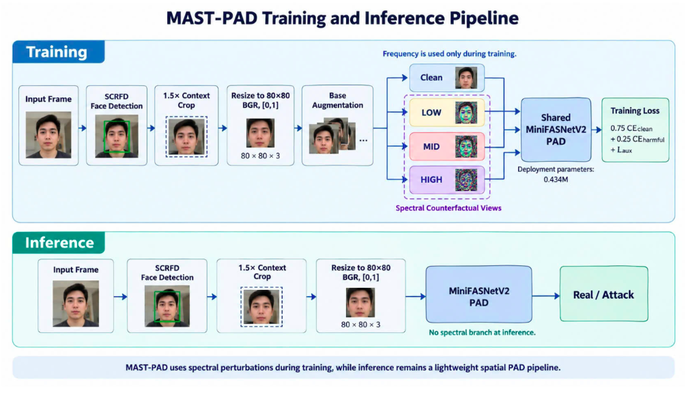
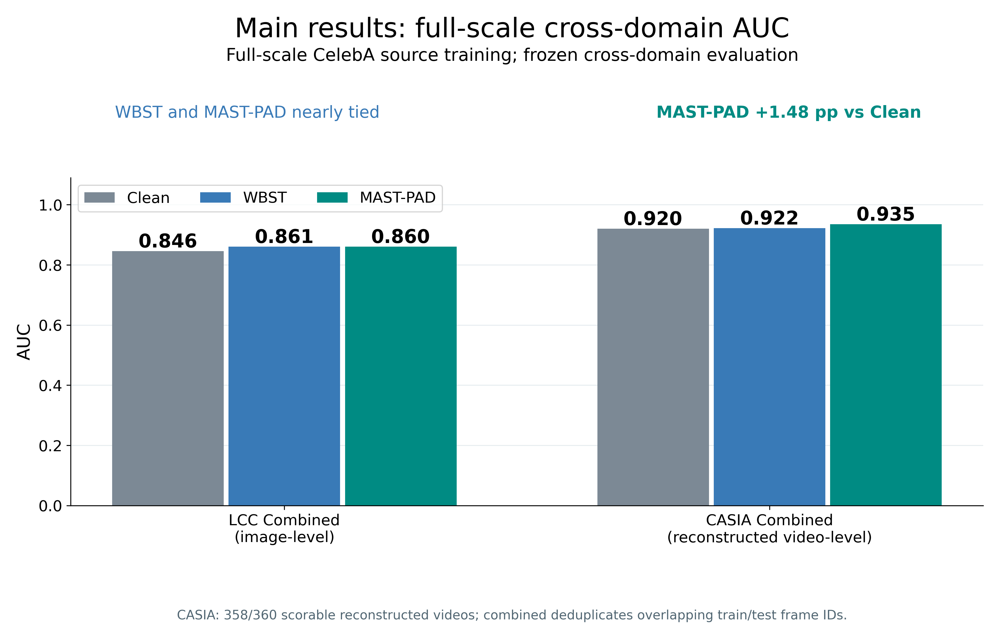
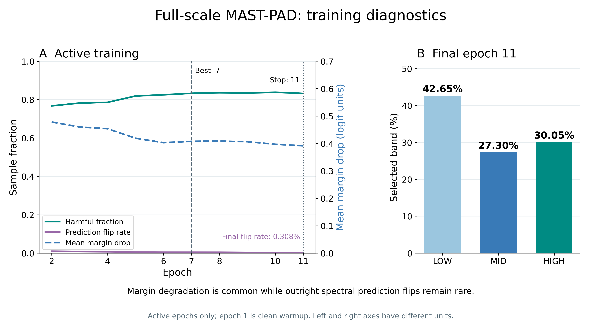
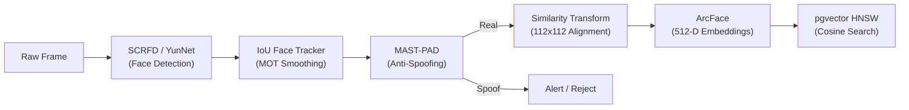

# MAST-PAD & Face-Auth: Margin-Aware Spectral Training for Lightweight Cross-Domain Face Anti-Spoofing

<div align="center">

[](https://www.python.org/)
[](https://pytorch.org/)
[](https://opencv.org/)
[](https://github.com/pgvector/pgvector)
[](https://github.com/locngodev6205/face-auth)
[](https://github.com/locngodev6205/face-auth)
[](https://github.com/locngodev6205/face-auth)
[](LICENSE)

</div>

> **Paper**: *MAST-PAD: Margin-Aware Spectral Training for Lightweight Cross-Domain Face Anti-Spoofing*  
> **Authors**: Quang Anh Nguyen, Van Loc Ngo  
> **Affiliation**: University of Science and Technology – The University of Danang, Vietnam  

---

## 📌 Overview

**Face-Auth** is an open-source, edge-optimized Computer Vision and Biometric Authentication framework featuring **MAST-PAD (Margin-Aware Spectral Training)** for state-of-the-art, lightweight Presentation Attack Detection (PAD / Anti-Spoofing), high-speed **Face Detection**, **Canonical 5-Point Alignment**, **Multi-Target Video Tracking**, and **ArcFace Deep Metric Recognition**.

### Key Highlight: Pure Spatial Inference with Zero Spectral Overhead
Unlike conventional frequency-based anti-spoofing methods that mandate dual-branch architectures or frequency transformations during deployment, **MAST-PAD uses spectral interventions strictly as a training stressor**. At inference time, the model runs as a **compact, purely spatial MiniFASNetV2 network**:
* **Total Deployed Parameters**: **434,434 (0.434M)**
* **Model Size**: **~1.74 MB** (FP32 raw weights)
* **Computational Cost**: **40.81M MACs (~0.0816 GFLOPs)** per $80 \times 80$ input crop
* **Zero Runtime Overhead**: No Fourier transforms, no candidate generators, no auxiliary prediction heads at deployment!

---

## 📑 Table of Contents
- [MAST-PAD Methodology](#-mast-pad-methodology)
  - [1. Smooth Spectral Counterfactuals](#1-smooth-spectral-counterfactuals)
  - [2. Label-Aligned Margin & Worst-View Selection](#2-label-aligned-margin--worst-view-selection)
  - [3. Detached Harmful Gate & Count-Normalized Loss](#3-detached-harmful-gate--count-normalized-loss)
  - [4. Compact Spatial Deployment](#4-compact-spatial-deployment)
- [Experimental Benchmarks & Results](#-experimental-benchmarks--results)
  - [Cross-Domain Strategy Comparison (CelebA-Spoof Source)](#cross-domain-strategy-comparison-celeba-spoof-source)
  - [Comparison with Literature (LCC-FASD & CASIA-FASD)](#comparison-with-literature-lcc-fasd--casia-fasd)
  - [Training Diagnostics & Margin Sensitivity](#training-diagnostics--margin-sensitivity)
- [End-to-End Face Authentication Pipeline](#-end-to-end-face-authentication-pipeline)
  - [1. Face Detection & Landmark Extraction](#1-face-detection--landmark-extraction)
  - [2. Multi-Target Video Tracking (MOT)](#2-multi-target-video-tracking-mot)
  - [3. Canonical Similarity Alignment](#3-canonical-similarity-alignment)
  - [4. ArcFace 512-D Embeddings](#4-arcface-512-d-embeddings)
  - [5. Centroid Enrollment & Vector Database](#5-centroid-enrollment--vector-database)
- [Edge AI Asynchronous Execution](#-edge-ai-asynchronous-execution)
- [Directory Structure](#-directory-structure)
- [Installation & Setup](#-installation--setup)
- [Quick Start](#-quick-start)
  - [1. Live Camera Inference Application](#1-live-camera-inference-application)
  - [2. FastAPI Biometric Microservice](#2-fastapi-biometric-microservice)
  - [3. Batch Identity Enrollment](#3-batch-identity-enrollment)
- [Citation](#-citation)
- [License](#-license)

---

## 🔬 MAST-PAD Methodology

<p align="center">
  
</p>

MAST-PAD treats frequency variations as controlled probes during training to expose fragile decisions of a compact spatial classifier without increasing its inference capacity.

### 1. Smooth Spectral Counterfactuals
Given an augmented base face crop $x_i \in \mathbb{R}^{80 \times 80 \times 3}$, we compute the 2D orthonormal Discrete Fourier Transform $\mathcal{F}$ per color channel with zero-frequency centered. The normalized radial distance on the centered grid $u, v \in \{-40, \dots, 39\}$ is defined as:

$$
r(u, v) = \frac{\sqrt{u^2 + v^2}}{\sqrt{2 \cdot 40^2}}
$$

Three smooth radial Gaussian attenuation profiles are centered at $c_L = 1/12$, $c_M = 1/4$, and $c_H = 5/12$ representing **LOW**, **MID**, and **HIGH** spectral bands:

$$
a_k(r) = \exp\left( -\frac{(r - c_k)^2}{2\sigma^2} \right), \quad k \in [L, M, H], \quad \sigma = 0.10
$$

A random attenuation gain $g_i \sim \mathcal{U}(0.65, 0.90)$ is sampled per instance and shared across all three bands. The spectral transfer multiplier with an explicit DC override is defined piecewise:

* For the DC zero-frequency coefficient $(u, v) = (0, 0)$: $G_{i,k}(0, 0) = 1$
* For all radial spatial frequencies $(u, v) \neq (0, 0)$: $G_{i,k}(u, v) = 1 - (1 - g_i) a_k(r(u, v))$

The counterfactual spatial views are reconstructed via inverse FFT while preserving original Fourier phase:

$$
x_i^k = \text{clip}( \Re[ \mathcal{F}^{-1}( G_{i,k} \odot \mathcal{F}(x_i) ) ], 0, 1 )
$$

### 2. Label-Aligned Margin & Worst-View Selection
The network predicts binary logits $f_\theta(x) = (z_{\text{Real}}, z_{\text{Attack}})$. The decision score and label-aligned classification margin are:

$$
d_\theta(x) = z_{\text{Real}}(x) - z_{\text{Attack}}(x)
$$

$$
m_\theta(x, y) = s_y \cdot d_\theta(x)
$$

where $s_y = +1$ for Real genuine samples, and $s_y = -1$ for Attack spoof samples.

A larger aligned margin indicates stronger confidence for the ground-truth class. In a no-gradient evaluation pass ($\bar{f}_\theta$), MAST-PAD selects the spectral candidate that produces the **minimum aligned margin**:

$$
k_i^* = \arg\min_{k \in [L, M, H]} m_i^k, \quad x_i^* = x_i^{k_i^*}
$$

### 3. Detached Harmful Gate & Count-Normalized Loss
A candidate view is defined as **harmful** if and only if it strictly reduces the decision margin below the clean base margin $m_i^0$:

$$
h_i = \mathbf{1}[ m_i^{k_i^*} < m_i^0 ], \quad H = \sum_{i=1}^B h_i
$$

The detached gate activates even when the predicted class does not flip: a smaller positive margin represents weakened decision support. The harmful spectral loss is normalized by the count of active harmful samples $H$:

* When $H > 0$ (at least one candidate reduces the margin): $\mathcal{L}_{\text{harm}} = \frac{1}{H} \sum_{i=1}^B h_i \cdot \text{CE}(f_\theta(x_i^*), y_i)$
* When $H = 0$ (no candidate degrades the margin): $\mathcal{L}_{\text{harm}} = 0$

The overall training objective combines clean cross-entropy, harmful spectral supervision, and semantic auxiliary heads (11 spoof types, 5 lighting classes, 40 facial attributes):

$$
\mathcal{L}_{\text{clean}} = \frac{1}{B} \sum_{i=1}^B \text{CE}(f_\theta(x_i), y_i)
$$

$$
\mathcal{L}_{\text{aux}} = 0.1 \mathcal{L}_{\text{spoof}} + 0.1 \mathcal{L}_{\text{light}} + \mathcal{L}_{\text{attr,real}}
$$

After a 1-epoch clean warmup, the final MAST objective is:

$$
\mathcal{L}_{\text{MAST}} = 0.75 \mathcal{L}_{\text{clean}} + 0.25 \mathcal{L}_{\text{harm}} + \mathcal{L}_{\text{aux}}
$$

### 4. Compact Spatial Deployment
At deployment time, all spectral operations, Fourier transforms, candidate selectors, harmful gates, and auxiliary heads are discarded. The deployed system executes a **single-stream spatial forward pass**:

```text
Input Frame -> SCRFD (1.5x Context Crop) -> 80x80 BGR -> MiniFASNetV2 -> Binary Logits (Real / Attack)
```

---

## 📊 Experimental Benchmarks & Results

### Cross-Domain Strategy Comparison (CelebA-Spoof Source)
All models were trained on **484,561 usable images** from the official CelebA-Spoof training set and evaluated directly on target domains **without any fine-tuning or domain adaptation**:

| Strategy | Clean CE | Clean Aux | Spectral View | Harmful Gate | Gaussian $\sigma$ | CelebA Val AUC (%) | LCC Combined AUC (%) | CASIA Combined AUC (%) | Parameters |
| :--- | :---: | :---: | :---: | :---: | :---: | :---: | :---: | :---: | :---: |
| **CE-only** | Yes | No | None | No | — | 99.21 | 84.40 | 89.83 | 434,434 |
| **C-clean** | Yes | Yes | None | No | — | 99.07 | 84.60 | 92.04 | 434,434 |
| **WBST** | Yes | Yes | Worst of 3 | No | $1/18$ | 99.22 | **86.08** | 92.23 | 434,434 |
| **MAST-PAD (Ours)**| **Yes** | **Yes** | **Worst of 3** | **Yes** | **0.10** | **99.23** | **86.03** | **93.52** | **434,434** |

<p align="center">
  
</p>

* **CASIA Video Gains**: MAST-PAD achieves **93.52% AUC** on deduplicated reconstructed CASIA videos, outperforming CE-only by **+3.69 pp**, C-clean by **+1.48 pp**, and WBST by **+1.29 pp**.
* **LCC Image Generalization**: MAST-PAD reaches **86.03% AUC** across 18,794 pooled LCC-FASD images (+1.63 pp over CE-only).

---

### Comparison with Literature (LCC-FASD & CASIA-FASD)

#### LCC-FASD Dataset Context:
| Method | AUC (%) | Parameters | Backbones & Reference |
| :--- | :---: | :---: | :--- |
| **Graph Transformer** | 83.30 | ~10.84M | Trinh et al. (ESANN 2023) |
| **AENet** | 86.80 | 11.22M | CelebA-Spoof Benchmark (ECCV 2020) |
| **MAST-PAD (Ours)** | **86.03** | **0.434M** | **MiniFASNetV2 (~25.8x fewer parameters than AENet)** |

#### CASIA-FASD Cross-Domain Context:
| Method | Target AUC (%) | Protocol Setting | Architectural Family |
| :--- | :---: | :---: | :--- |
| **MADDG** (CVPR 2019) | 84.51 | $\text{OMI} \to \text{C}$ | MADDG Architecture (3.35M params) |
| **AMEL** (ACM MM 2022) | 94.39 | $\text{OMI} \to \text{C}$ | Multi-Domain Experts |
| **PatchNet** (CVPR 2022) | 94.58 | $\text{OMI} \to \text{C}$ | ResNet-18 Backbone |
| **GAC-FAS** (CVPR 2024) | 95.16 | $\text{OMI} \to \text{C}$ | ResNet-18 Backbone |
| **SA-FAS** (CVPR 2023) | 95.37 | $\text{OMI} \to \text{C}$ | ResNet-18 Backbone |
| **MAST-PAD (Ours)** | **93.52** | $\text{CelebA} \to \text{CASIA}$ | **MiniFASNetV2 (Only 0.434M parameters)** |

---

### Training Diagnostics & Margin Sensitivity

<p align="center">
  
</p>

* **Margin Deterioration vs. Sign Flips**: In the final training epoch (epoch 11), **83.21%** of selected counterfactual views activated the harmful gate, whereas only **0.31%** caused an outright sign flip (misclassification).
* **Takeaway**: Conventional hard-example mining only penalizes misclassified samples, ignoring views that dangerously weaken the decision boundary. The harmful gate directly supervises these degraded representations before label errors occur.
* **Band Distribution**: Selected view distribution across LOW (42.65%), MID (27.30%), and HIGH (30.05%) proves that vulnerabilities span across the entire spectral frequency spectrum.

---

## 🔍 End-to-End Face Authentication Pipeline

In addition to MAST-PAD anti-spoofing, this repository provides a complete biometric authentication pipeline:



### 1. Face Detection & Landmark Extraction
* Backbones: **SCRFD-500M** and **OpenCV YunNet** (INT8 quantized, ~122 KB).
* Outputs: Bounding box coordinates and 5 primary facial landmarks (Left Eye, Right Eye, Nose Tip, Left Mouth Corner, Right Mouth Corner).
* Anti-spoofing crop: Adaptive $1.55\times$ bounding box contextual expansion.

### 2. Multi-Target Video Tracking (MOT)
* IoU spatial tracker associating identities across frames with velocity and coordinate smoothing.
* Prevents identity flipping and handles momentary occlusions in multi-person scenarios.

### 3. Canonical Similarity Alignment
* Computes least-squares Procrustes similarity transformation matrix $\mathbf{M}$ mapping 5 detected landmarks to canonical reference coordinates.
* Warps face crops into standardized $112 \times 112 \times 3$ RGB tensors, robust to in-plane head tilt.

### 4. ArcFace 512-D Embeddings
* Additive Angular Margin Loss (ArcFace):
  
$$
\mathcal{L}_{\text{ArcFace}} = -\frac{1}{N} \sum_{i=1}^N \log \frac{e^{s(\cos(\theta_{y_i} + m))}}{e^{s(\cos(\theta_{y_i} + m))} + \sum_{j \neq y_i} e^{s \cos \theta_j}}
$$

* Extracts $L_2$-normalized 512-dimensional vectors ($\|\mathbf{f}\|_2 = 1$).
* Model backbones: `buffalo_s` (MobileFaceNet, ultra-lightweight) and `buffalo_l` (ResNet-50).

### 5. Centroid Enrollment & Vector Database
* **Outlier Filtering**: Calculates inter-sample cosine distances $d(\mathbf{f}_i, \mathbf{f}_j) = 1 - \mathbf{f}_i^\top \mathbf{f}_j$ to reject poor quality enrollment captures.
* **Normalized Identity Centroid**:

$$
\mathbf{c} = \frac{\sum_{k=1}^K \mathbf{f}_k}{\| \sum_{k=1}^K \mathbf{f}_k \|_2}
$$

* **Vector Search Engine**: PostgreSQL 16 + `pgvector` with HNSW indexing ($M=16, \text{efConstruction}=64$) for sub-millisecond cosine distance querying over large identity galleries.

---

## ⚡ Edge AI Asynchronous Execution

To maintain 30+ FPS video streaming on edge platforms like Raspberry Pi 4 (Quad-Core Cortex-A72 @ 1.5GHz), Face-Auth decouples vision tracking from heavy biometric vector extraction:

```text
[Camera Capture Loop] (30+ FPS, Zero-Copy BGR Frame Buffer)
       │
       ├──► [SCRFD / YunNet Face Detection] (~15-20 ms)
       │
       ├──► [MAST-PAD Inference] (~2.2 ms on CPU)
       │
       └──► [Asynchronous Worker Dispatcher]
                  │ (Bounded queue, size = 2)
                  ▼
        [Background Recognition Thread]
           ├── ArcFace Feature Extraction (512-D)
           ├── Track Centroid Memoization (TTL = 30s)
           └── Database Vector Search (pgvector HNSW)
```

* **Zero-Lag Video**: The UI and camera stream remain uninterrupted.
* **Track Memoization**: Once a face trajectory is verified, its identity is cached for the duration of the track, eliminating redundant inference cycles.

---

## 📁 Directory Structure

```text
face-auth/
├── app.py                     # Real-time camera GUI app with live PAD & recognition overlay
├── api_service.py             # Headless FastAPI microservice (vector extraction & enrollment)
├── config.py                  # Global configurations (thresholds, model paths, DB connections)
├── requirements.txt           # Python library dependencies
├── .env.example               # Environment variables template
├── LICENSE                    # MIT License
│
├── alignment/                 # Canonical 5-point face alignment via Similarity Transform
│   └── aligner.py
│
├── antispoof/                 # Presentation Attack Detection (PAD)
│   ├── predictor.py           # Unified inference runner (supports ONNX and PyTorch)
│   ├── preprocess.py          # Crop scaling, color normalization, and bounding box expansion
│   ├── lighting.py            # Illumination-aware adaptive gamma correction
│   ├── models/                # Production ONNX checkpoints and runtime configs
│   │   ├── R7_SC_FULL_crop15.onnx            # Pre-trained MAST-PAD model
│   │   └── smartface_pad_artifacts/          # E1, E2, E3 model artifacts
│   └── notebooks/             # Research & training notebooks
│
├── database/                  # Vector database layer
│   ├── vector_db.py           # PostgreSQL connection pool & pgvector HNSW search
│   └── schema.sql             # SQL schema for identities and face_embeddings
│
├── detection/                 # Deep face detection backbones
│   ├── detector.py            # InsightFace SCRFD wrapper
│   └── yunnet_detector.py     # OpenCV YunNet wrapper
│
├── enrollment/                # Biometric enrollment & centroid math
│   └── enroll.py              # Pairwise distance outlier rejection & centroid calculation
│
├── slide_figures_mast_pad_fullscale/ # Publication figures, diagrams, and benchmarks
│   ├── fig_mast_pad_method_flow.png
│   ├── fig_main_ablation_two_target_auc.png
│   └── fig_mast_pad_training_diagnostics.png
│
├── scripts/                   # Utility and calibration CLI tools
│   ├── run_enroll.py          # Batch directory enrollment
│   ├── calibrate_domain_threshold.py # Adaptive threshold calibrator
│   └── list_cameras.py        # Probes attached camera devices
│
└── tests/                     # Unit and regression test suite
    ├── test_detection.py
    ├── test_pad_predictor.py
    └── test_runtime.py
```

---

## 🛠️ Installation & Setup

### 1. Requirements
* **Python**: `3.10` or `3.11`
* **OS**: Linux (Ubuntu 20.04+, Debian, Raspberry Pi OS 64-bit), macOS, or Windows
* **Camera**: USB Webcam, CSI Camera, or RTSP Video Stream

### 2. Environment Setup
```bash
# Clone the repository
git clone git@github.com:locngodev6205/face-auth.git
cd face-auth

# Create and activate Python virtual environment
python3 -m venv .venv
source .venv/bin/activate       # On Linux/macOS
# or: .venv\Scripts\activate    # On Windows

# Install dependencies
pip install --upgrade pip
pip install -r requirements.txt
```

### 3. Configure `.env`
```bash
cp .env.example .env
```
Key configuration settings in `.env`:
* `DATABASE_URL`: Connection string for PostgreSQL with `pgvector`.
* `APP_DETECTOR`: `scrfd` (higher accuracy) or `yunnet` (ultra-lightweight edge).
* `PAD_ENABLED`: `true` to enable anti-spoofing verification.
* `PAD_MODEL_NAME`: Name of the active ONNX model (e.g. `R7_SC_FULL_crop15.onnx`).
* `MATCH_THRESHOLD`: Cosine distance cutoff threshold for identity verification (default `0.35`).

---

## 🚀 Quick Start

### 1. Live Camera Inference Application
Launch the real-time application with camera feed, PAD liveness detection, and facial recognition:

```bash
# Run with default camera index 0 and active MAST-PAD
python app.py

# Specify camera device index
python app.py --camera 1

# Select specific PAD ONNX model
python app.py --pad-model antispoof/models/R7_SC_FULL_crop15.onnx

# Maximum performance mode on low-resource hardware
python app.py --no-fps
```

**Controls**:
* Press `Q` or `ESC` to exit.
* Press `C` to capture current face crop to disk for evaluation.

### 2. FastAPI Biometric Microservice
Start the headless REST API service on port `5000`:

```bash
uvicorn api_service:app --host 0.0.0.0 --port 5000 --workers 2
```

* `GET /health`: Health check and model readiness.
* `POST /internal/face-embedding`: Extracts a 512-D normalized vector from a base64 encoded image.
* `POST /internal/enroll`: Performs outlier filtering and enrolls identity centroids into the vector database.

### 3. Batch Identity Enrollment
Enroll employee/user identity galleries structured in subfolders:

```text
gallery/
├── EMP001_Alice/
│   ├── img1.jpg
│   └── img2.jpg
└── EMP002_Bob/
    ├── img1.jpg
    └── img2.jpg
```

Run batch enrollment:
```bash
python scripts/run_enroll.py --gallery gallery
```

---

## 📖 Citation

If you find **MAST-PAD** or this codebase helpful in your research or project, please cite:

```bibtex
@article{nguyen2026mastpad,
  title={MAST-PAD: Margin-Aware Spectral Training for Lightweight Cross-Domain Face Anti-Spoofing},
  author={Nguyen, Quang Anh and Ngo, Van Loc},
  journal={University of Science and Technology -- The University of Danang},
  year={2026}
}
```

---

## 📄 License
This project is open-source under the [MIT License](LICENSE).
